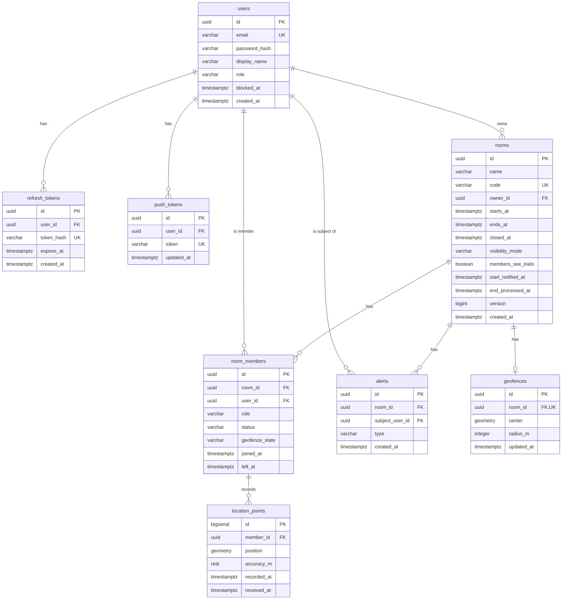

# Rendezvous

Rendezvous to aplikacja do **tymczasowego** dzielenia się lokalizacją w grupie. Ktoś zakłada pokój z oknem czasowym, inni dołączają przez link albo kod, a w trakcie trwania pokoju uczestnicy widzą się na mapie na żywo. Pokój kończy się sam, a dane tras są wtedy usuwane.

## Scenariusze użycia

1. **Znajomi** (impreza, festiwal) — wszyscy widzą wszystkich.
2. **Wycieczka zorganizowana** — przewodnik i pilot widzą całą grupę, turyści widzą tylko opiekunów. Link wysyłany dzień wcześniej, pokój startuje o ustalonej godzinie.
3. **Rodzic i dzieci** — opiekunowie widzą dzieci i ich trasy, wyznaczają strefę i dostają powiadomienie, gdy dziecko z niej wyjdzie, wróci albo opuści pokój. Telefon dziecka wysyła pozycję z zablokowanym ekranem.

## Technologie

- Java 25, Spring Boot 4.1.2 (Web MVC, Validation, Data JPA, Actuator)
- PostgreSQL 18 + PostGIS 3.7 (obraz `postgis/postgis:18-3.7`), Hibernate Spatial
- Flyway (schemat wyłącznie z migracji `V1…V7`)
- Spring Security: JWT (resource server) + rotowane refresh tokeny
- WebSocket (`/ws`) do rozsyłania zdarzeń na żywo
- Expo Push Service do powiadomień push
- springdoc-openapi (Swagger UI)
- Testy: JUnit 5, Mockito, Spring Boot Test, MockMvc, Testcontainers
- CI: GitHub Actions
- Aplikacja mobilna: React Native (Expo SDK 58, Expo Router, TypeScript), TanStack Query, Zustand, `openapi-fetch`, Jest

## Uruchomienie (Docker Compose)

Wymagany Docker z Compose.

```bash
cp .env.example .env
# uzupełnij .env (patrz tabela niżej)
docker compose up -d --build
```

Backend nasłuchuje na `http://localhost:8080`. Baza i backend startują z jednego `docker-compose.yml`; backend czeka na zdrową bazę. Kontener bazy dostaje z `.env` tylko zmienne `POSTGRES_*`; pozostałe sekrety trafiają wyłącznie do backendu.

Obraz `postgis/postgis` jest dostępny tylko dla amd64, więc na Apple Silicon działa w emulacji (`platform: linux/amd64`) i pierwsze uruchomienie jest wolniejsze.

### Zmienne środowiskowe (`.env`)

| Zmienna | Opis |
|---|---|
| `POSTGRES_DB`, `POSTGRES_USER`, `POSTGRES_PASSWORD` | nazwa bazy i dane dostępowe użytkownika bazy (wartości domyślne w `.env.example`; zmień hasło) |
| `JWT_SECRET` | sekret podpisu tokenów JWT (HS256), **min. 32 znaki**; wymagany |
| `APP_ADMIN_EMAIL`, `APP_ADMIN_PASSWORD` | dane pierwszego konta administratora systemu; przy starcie, jeśli oba są ustawione, konto jest tworzone, gdy jeszcze nie istnieje; hasło najwyżej 72 bajty w UTF-8 (limit BCrypt), dłuższe zatrzymuje start |
| `EXPO_ACCESS_TOKEN` | opcjonalny token zabezpieczający wysyłkę przez Expo Push; może być pusty |

### Dokumentacja API (Swagger)

- Swagger UI: `http://localhost:8080/swagger-ui.html`
- OpenAPI JSON: `http://localhost:8080/v3/api-docs`

## Testy

```bash
cd backend
./mvnw verify
```

Testy integracyjne używają Testcontainers (`postgis/postgis:18-3.7`), więc **Docker musi działać**. Te same testy uruchamia workflow `Backend CI` (`.github/workflows/backend.yml`) na każdy push i pull request do `main`. Profil testowy ma własny sekret JWT, wyłączony scheduler i adres push wskazujący nieosiągalny port lokalny, więc testy nic nie wysyłają do Expo.

## Główne funkcje

- rejestracja, logowanie, odświeżanie i unieważnianie tokenów, profil użytkownika
- pokoje z oknem czasowym (planowane, aktywne, zakończone), kod i dołączanie po kodzie, role w pokoju
- przyjmowanie pozycji w paczkach (także z telefonu w tle), ostatnie pozycje i trasy z kontrolą widoczności
- tryby widoczności (`ALL`, `GUARDIANS_ONLY`) i opcjonalny dostęp uczestników do tras
- strefa (okrąg, PostGIS) z alertami wyjścia i powrotu oraz alert opuszczenia pokoju
- rozsyłanie zdarzeń na żywo przez WebSocket
- powiadomienia push (start pokoju, alerty, usunięcie z pokoju)
- automatyczny start i koniec pokoju (scheduler) z usuwaniem tras po zakończeniu
- panel administratora systemu: lista użytkowników i pokoi (tylko metadane), blokowanie użytkowników, zamykanie pokoi

## Model danych



Stan pokoju (`SCHEDULED` / `ACTIVE` / `ENDED`) nie jest przechowywany — jest wyliczany z `starts_at`, `ends_at` i `closed_at` względem aktualnego czasu. Kolumny geometryczne to `geometry(Point,4326)`; odległości w metrach liczone są po rzutowaniu na `geography`.

## REST API

Pełna, aktualna specyfikacja: Swagger UI (patrz wyżej). Poniżej zestawienie endpointów. „Uwierzytelniony” oznacza nagłówek `Authorization: Bearer <accessToken>`; „opiekun” to właściciel lub admin pokoju.

| Metoda | Ścieżka | Kto | Opis | Sukces |
|---|---|---|---|---|
| POST | `/api/auth/register` | publiczny | rejestracja, zwraca tokeny | 201 |
| POST | `/api/auth/login` | publiczny | logowanie, zwraca tokeny | 200 |
| POST | `/api/auth/refresh` | publiczny | wymiana refresh tokenu na nową parę tokenów | 200 |
| POST | `/api/auth/logout` | publiczny | unieważnienie refresh tokenu | 204 |
| GET | `/api/me` | uwierzytelniony | profil | 200 |
| PATCH | `/api/me` | uwierzytelniony | zmiana nazwy wyświetlanej | 200 |
| PUT | `/api/me/push-tokens/{token}` | uwierzytelniony | rejestracja tokenu push urządzenia | 204 |
| DELETE | `/api/me/push-tokens/{token}` | uwierzytelniony | usunięcie tokenu push | 204 |
| POST | `/api/me/locations` | uwierzytelniony | paczka 1–50 pozycji; zwraca `{activeRoomCount}` | 200 |
| GET | `/api/me/rooms` | uwierzytelniony | moje pokoje (filtr `status`, stronicowanie) | 200 |
| POST | `/api/rooms` | uwierzytelniony | utworzenie pokoju (twórca zostaje właścicielem) | 201 |
| POST | `/api/rooms/join` | uwierzytelniony | dołączenie po kodzie | 200 |
| GET | `/api/rooms/{id}` | członek | szczegóły pokoju (z kodem i strefą) | 200 |
| PATCH | `/api/rooms/{id}` | opiekun | zmiana nazwy, okna czasowego, ustawień; wymaga `version` | 200 |
| POST | `/api/rooms/{id}/close` | właściciel | zakończenie pokoju przed czasem | 204 |
| DELETE | `/api/rooms/{id}` | właściciel | usunięcie pokoju | 204 |
| POST | `/api/rooms/{id}/leave` | członek (nie właściciel) | opuszczenie pokoju | 204 |
| GET | `/api/rooms/{id}/members` | członek | lista członków (bez `lastSeenAt`, patrz niżej) | 200 |
| PATCH | `/api/rooms/{id}/members/{userId}` | właściciel | zmiana roli `MEMBER` / `ADMIN` | 200 |
| DELETE | `/api/rooms/{id}/members/{userId}` | właściciel / admin pokoju | usunięcie członka | 204 |
| GET | `/api/rooms/{id}/locations/latest` | członek | ostatnie widoczne pozycje | 200 |
| GET | `/api/rooms/{id}/members/{userId}/trail` | członek (wg reguły widoczności) | trasa wskazanego członka | 200 |
| PUT | `/api/rooms/{id}/geofence` | opiekun | utworzenie lub zmiana strefy | 200 |
| DELETE | `/api/rooms/{id}/geofence` | opiekun | usunięcie strefy (idempotentne) | 204 |
| GET | `/api/rooms/{id}/alerts` | opiekun | historia alertów (filtr `type`, stronicowanie) | 200 |
| GET | `/api/admin/users` | `ADMIN` systemu | użytkownicy (filtry `query`, `blocked`, stronicowanie) | 200 |
| PUT | `/api/admin/users/{id}/block` | `ADMIN` systemu | zablokowanie użytkownika | 204 |
| DELETE | `/api/admin/users/{id}/block` | `ADMIN` systemu | odblokowanie użytkownika | 204 |
| GET | `/api/admin/rooms` | `ADMIN` systemu | pokoje, tylko metadane (filtry `status`, `from`, `to`) | 200 |
| POST | `/api/admin/rooms/{id}/close` | `ADMIN` systemu | zamknięcie pokoju | 204 |

Uwagi:

- W `/api/rooms/{id}/members/{userId}` `{userId}` to identyfikator użytkownika będącego członkiem (pole `userId` z listy członków), a nie osobny identyfikator członkostwa.
- `GET /api/rooms/{id}/members` zwraca `userId`, `displayName`, `role`, `joinedAt`. Czas ostatniej pozycji klient bierze z `recordedAt` w `/locations/latest`; członek widoczny na liście, a nieobecny w `latest`, nie udostępnia pozycji albo patrzący nie ma prawa jej widzieć (tryb `GUARDIANS_ONLY`).
- Błędy mają format `ProblemDetail` z polem `code` i (dla walidacji) listą `errors: [{field, message}]`.
- Stronicowanie: domyślnie 20 elementów, maksymalnie 100.

## WebSocket

- Endpoint: `/ws`. Uwierzytelnienie przy handshake nagłówkiem `Authorization: Bearer <accessToken>` (ten sam dekoder JWT co w REST).
- Kanał jednokierunkowy (serwer do klienta). Wiadomość: `{ "type": "...", "roomId": "...", "payload": { ... } }`.
- Serwer wysyła odbiorcy tylko to, co wolno mu zobaczyć (pozycje wg reguły widoczności, alerty tylko opiekunom).
- Token jest sprawdzany tylko przy handshake; serwer zamyka sesje siłą wyłącznie przy blokadzie użytkownika.

| `type` | `payload` | Odbiorcy |
|---|---|---|
| `LOCATION_UPDATED` | `{userId, lat, lon, accuracyM, recordedAt}` | członkowie uprawnieni do pozycji tej osoby |
| `MEMBER_JOINED`, `MEMBER_LEFT`, `MEMBER_REMOVED`, `MEMBER_ROLE_CHANGED` | `{userId}` | członkowie pokoju (usunięty też dostaje `MEMBER_REMOVED`) |
| `ROOM_UPDATED`, `GEOFENCE_UPDATED` | `{}` | członkowie pokoju |
| `ALERT_CREATED` | `{alertId, type, userId}` | opiekunowie |
| `ROOM_STARTED`, `ROOM_ENDED` | `{}` | członkowie pokoju |

## Reguły biznesowe

- **Okno czasowe** — czas trwania pokoju 15 min – 72 h, start najwyżej 30 dni naprzód (tolerancja zegara 1 min); pokój `SCHEDULED` można edytować, `ACTIVE` tylko przedłużyć, `ENDED` nie.
- **Dołączanie** — kod bez rozróżniania wielkości liter; zakończony pokój → 409, usunięty członek → 403, ponowne dołączenie po wyjściu dozwolone, dołączenie jako już aktywny jest idempotentne.
- **Limit członków** — maks. 50 aktywnych członków, sprawdzane z blokadą wiersza pokoju (odporność na wyścig).
- **Widoczność** — `ALL` albo `GUARDIANS_ONLY`; uczestnik widzi trasy tylko przy `membersSeeTrails` i tylko osób, których pozycję widzi; jeden komponent decyzyjny dla REST i WebSocket.
- **Przyjmowanie pozycji** — paczka 1–50 punktów; punkty spoza okna `[now − 15 min, now + 1 min]` są odrzucane po cichu; zapis osobno dla każdego aktywnego pokoju, tylko punkty z okna pokoju liczonego od późniejszego z momentów: startu pokoju i dołączenia członka; odpowiedź zawiera `activeRoomCount`.
- **Strefa i alerty** — jedna strefa na pokój (50–5000 m), dotyczy tylko uczestników; stany `UNKNOWN`/`INSIDE`/`OUTSIDE`, alerty `GEOFENCE_EXIT` i `GEOFENCE_RETURN`; dokładność > 100 m nie zmienia stanu; zmiana strefy resetuje stany.
- **Role w pokoju** — tylko właściciel zmienia rolę `MEMBER` / `ADMIN`; roli `OWNER` nie można nadać ani odebrać.
- **Usuwanie członków** — właściciel usuwa adminów i uczestników, admin pokoju tylko uczestników; usunięty nie może wrócić i dostaje push.
- **Opuszczanie pokoju** — admin i uczestnik mogą wyjść w każdej chwili; właściciel może tylko zakończyć pokój; wyjście z niezakończonego pokoju tworzy alert `MEMBER_LEFT`.
- **Retencja** — po zakończeniu pokoju punkty tras są usuwane; pokój, członkostwa i alerty (bez współrzędnych) zostają jako historia. Przyjmowanie pozycji i obsługa końca pokoju blokują ten sam wiersz pokoju, więc żaden punkt nie przetrwa jego zakończenia.
- **Prywatność wobec admina systemu** — endpointy admina zwracają tylko metadane; sama rola `ADMIN` nie daje dostępu do pozycji, tras ani alertów pokoi.
- **Blokada użytkownika** — zablokowany nie zaloguje się ani nie odświeży tokenu (403), traci tokeny odświeżania, jego członkostwa w niezakończonych pokojach są usuwane, a jego pokoje zamykane i sesje WebSocket zamykane; admina systemu nie można zablokować.
- **Równoczesna edycja** — optimistic locking pokoju (`version`), konflikt → 409 `ROOM_VERSION_CONFLICT`.
- **Kod pokoju** — 6 znaków z alfabetu `ABCDEFGHJKMNPQRSTUVWXYZ23456789`, unikalny globalnie; kolizja powoduje ponowne losowanie.

## Architektura

Aplikacja jest podzielona na moduły funkcjonalne w pakiecie `com.rendezvous`: `auth`, `user`, `room`, `location`, `geofence`, `alert`, `admin`, `notification`, `realtime` oraz `common` (błędy, czas, geometria). Każdy moduł ma warstwy `controller`, `service`, `repository`, `dto` i `domain` (tam, gdzie ma sens). Zależności między modułami są acykliczne.

Przepływ żądania: **kontroler** (walidacja, DTO) → **serwis** (logika, transakcja, uprawnienia) → **repozytorium** (Spring Data JPA / zapytania PostGIS) → **PostgreSQL**. Kontrolery nie zawierają logiki biznesowej; błędy rzucane jako `ApiException` mapuje jeden `GlobalExceptionHandler`. Czas pochodzi z wstrzykniętego `Clock`.

Skutki uboczne idą przez zdarzenia: serwisy publikują zdarzenia domenowe w transakcji, a słuchacze `@TransactionalEventListener(phase = AFTER_COMMIT)` + `@Async` rozsyłają je przez **WebSocket** (moduł `realtime`) i **push Expo** (moduł `notification`). Serwisy domenowe nie znają WebSocketu ani Expo. Ocena strefy odbywa się synchronicznie w transakcji zapisu punktów; asynchroniczne są tylko skutki uboczne.

`RoomLifecycleScheduler` działa co 60 s: oznacza start pokoi (zdarzenie `RoomStarted`, push) i przetwarza zakończenie (usunięcie tras, zdarzenie `RoomEnded`).

## Uwierzytelnianie i autoryzacja

- Rejestracja i logowanie (e-mail + hasło 8–72 znaków, najwyżej 72 bajty w UTF-8 — limit BCrypt) zwracają **access token JWT (15 min)** oraz **refresh token (30 dni)**. Refresh token jest rotowany przy każdym odświeżeniu, a w bazie przechowywany jest tylko jego skrót.
- Role systemowe: `USER` i `ADMIN`. Ścieżki `/api/admin/**` wymagają `ADMIN`; `/api/auth/**`, Swagger i `/actuator/health` są publiczne, reszta wymaga tokenu.
- Role w pokoju: `OWNER`, `ADMIN` (opiekun), `MEMBER`. Cała macierz uprawnień jest w jednym komponencie używanym przez serwisy:

| Akcja | Właściciel | Admin pokoju | Uczestnik |
|---|---|---|---|
| Widzi pozycje wszystkich i ich trasy | tak | tak | wg ustawień widoczności |
| Dostaje alerty i widzi ich historię | tak | tak | nie |
| Zmienia ustawienia, nazwę i okno czasowe | tak | tak | nie |
| Dodaje, zmienia i usuwa strefę | tak | tak | nie |
| Usuwa członków | adminów i uczestników | tylko uczestników | nie |
| Nadaje i odbiera rolę admina pokoju | tak | nie | nie |
| Kończy i usuwa pokój | tak | nie | nie |
| Wychodzi z pokoju | nie | tak | tak |
| Widzi kod pokoju i udostępnia zaproszenie | tak | tak | tak |

## Aplikacja mobilna

Aplikacja (React Native / Expo, Android i iOS) jest w katalogu `mobile/`. Używamy wyłącznie **pnpm** (nigdy `npm` ani `npx`). Workflow `Mobile CI` (`.github/workflows/mobile.yml`) na każdy push i pull request zmieniający `mobile/` uruchamia `pnpm install --frozen-lockfile`, `pnpm typecheck`, `pnpm lint` i `pnpm test --ci`.

### Wymagania i konfiguracja

- Node.js ≥ 22.13 i pnpm 12 (wersja jest przypięta w `mobile/package.json`).
- Działający backend (patrz „Uruchomienie (Docker Compose)”).

```bash
cp mobile/.env.example mobile/.env
cd mobile
pnpm install
```

| Zmienna (`mobile/.env`) | Opis |
|---|---|
| `EXPO_PUBLIC_API_URL` | adres backendu; `http://10.0.2.2:8080` dla emulatora Androida, dla telefonu adres IP komputera w tej samej sieci (np. `http://192.168.0.10:8080`); adres WebSocket jest z niego wyliczany (`/ws`) |
| `GOOGLE_MAPS_API_KEY` | klucz Google Maps SDK dla Androida (mapa w pełnym buildzie) |
| `EAS_PROJECT_ID` | identyfikator projektu EAS (tokeny push, buildy w chmurze) |
| `GOOGLE_SERVICES_JSON` | ścieżka do `google-services.json` z Firebase (push FCM na Androidzie) |

### Typy API

Typy w `mobile/src/api/schema.d.ts` są generowane z OpenAPI i commitowane. Plik źródłowy zapisuje test `OpenApiSpecExportTest` do `backend/target/openapi/openapi.json`; backend testuje się z Testcontainers, więc **Docker musi działać**.

```bash
cd backend
./mvnw test
cd ../mobile
pnpm gen:api
```

### Uruchomienie w Expo Go

```bash
cd mobile
pnpm start
```
